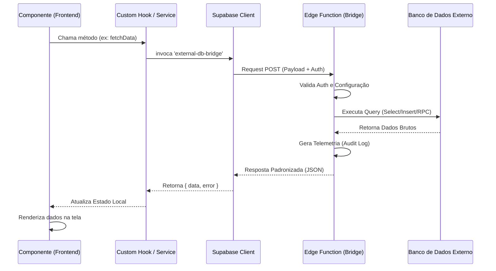

# Guia de Arquitetura - Freight Quest

## 🗺️ Mapa de Pastas e Responsabilidades

O projeto segue uma arquitetura modular baseada em React (Vite) e Supabase.

| Camada | Pasta | Responsabilidade |
| :--- | :--- | :--- |
| **Páginas** | `src/pages/` | Componentes de rota, gerenciam o estado macro da tela e compõem as seções. |
| **Componentes** | `src/components/` | UI Reutilizável. Dividida por domínio (ex: `compras/`, `admin/`) e base (`ui/` via shadcn). |
| **Hooks** | `src/hooks/` | Lógica de negócio, integração com queries e estados complexos. Quase toda a inteligência reside aqui. |
| **Serviços** | `src/services/` | Wrappers para APIs externas, persistência local e lógica de domínio pura (ex: `auditService`). |
| **Lib/Config** | `src/lib/` | Instâncias globais (Supabase, Logger, Utils utilitários). |
| **Backend** | `supabase/functions/` | Edge Functions para processamento pesado, integrações com IA e banco externo. |

---

## 🔄 Fluxo de Dados e Exemplo de Chamada

### Camadas de Execução:
1. **Componente UI**: Dispara uma ação (ex: clique em salvar).
2. **Hook**: Recebe a ação, valida dados e chama o serviço ou função.
3. **Serviço/Edge Function**: Executa a lógica pesada ou acessa o banco.
4. **Estado (React Query/Context)**: Atualiza o cache e reflete na UI.

### Exemplo Real (Solicitação Neural):
```typescript
// No Componente: NovaSolicitacaoModal.tsx
const { mutate } = useNeuralSolicitacao();
mutate(data);

// No Hook: useProdutos.ts (ou similar)
const processNeural = async (payload) => {
  const { data, error } = await supabase.functions.invoke('process-solicitacao-neural', {
    body: payload
  });
  return data;
};
```

---

## 🛠️ Contratos da Edge Function: `external-db-bridge`

Esta função atua como um proxy seguro para bancos de dados externos (ERP, Legados).

### 1. Request Format
**Endpoint:** `POST /functions/v1/external-db-bridge`

```json
{
  "operation": "select", 
  "table": "legacy_orders",
  "selectColumns": "id, status, total",
  "limit": 10,
  "offset": 0,
  "filters": {
    "status": { "operator": "eq", "value": "pending" }
  }
}
```

**Operações Suportadas:**
- `select`: Busca registros.
- `insert`: Cria novos registros (requer campo `data`).
- `update`: Atualiza (requer `data` e `filters`).
- `delete`: Remove (requer `filters`).
- `rpc`: Executa funções no banco externo (requer `rpcName` e `params`).

### 2. Response Format
```json
{
  "data": [...],
  "count": 100,
  "meta": {
    "durationMs": 145,
    "status": "ok",
    "recordCount": 10
  }
}
```

### 3. Tratamento de Erros
- **400 Bad Request**: Parâmetros inválidos ou erro de sintaxe SQL no banco externo.
- **401 Unauthorized**: Token JWT inválido ou ausente.
- **500 Internal Error**: Erro de configuração (ex: `EXTERNAL_DB_URL` não definida).

---

## 🛡️ Padrões Obrigatórios (External DB Bridge)

Para garantir segurança e performance ao usar o bridge, siga estas regras:

### 1. Paginação Obrigatória
Nunca faça requisições sem `limit`. O padrão é 100, mas especifique o necessário.
```json
{ "operation": "select", "table": "logs", "limit": 50 }
```

### 2. Filtros Fortes
Sempre utilize filtros específicos para evitar carregamento excessivo de dados. Prefira operadores explícitos.
```json
{
  "filters": {
    "tenant_id": "123",
    "status": { "operator": "eq", "value": "active" }
  }
}
```

### 3. Tratamento de Resposta
A resposta sempre contém um objeto `meta`. Use `meta.status` para telemetria no frontend.
- Se `status === "slow"`, exiba um indicador de carregamento otimizado.
- Sempre verifique o campo `error` na raiz do JSON de retorno.

### 4. Chamadas RPC
Para operações complexas, prefira criar uma `FUNCTION` no banco externo e chamá-la via `rpc` em vez de múltiplos `selects`.
```json
{
  "operation": "rpc",
  "rpcName": "get_consolidated_report",
  "params": { "start_date": "2024-01-01" }
}
```


---

## 📊 Diagrama de Sequência


