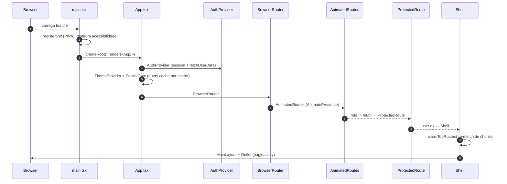

# 01. Arquitetura Geral

## Propósito
Sistema de **procurement corporativo multi-tenant** para um grupo empresarial com múltiplas empresas/CNPJs. Cobre solicitação → cotação → pedido → recebimento → pagamento, com fiscal, contratos, sourcing/leilão reverso, aprovações, orçamento e observabilidade.

## Stack

| Camada | Tecnologia |
|---|---|
| UI | React 18.2, TypeScript strict, Tailwind v3, shadcn/ui, Framer Motion |
| Estado | TanStack Query 5 (persistido em `localStorage`), Zustand, React Context |
| Roteamento | React Router v6 com `lazy()` + `Suspense` |
| Build | Vite 5 |
| Backend | Lovable Cloud (Supabase): Postgres + Auth + Storage + Realtime + Edge Functions (Deno) |
| IA | Lovable AI Gateway (Google Gemini 2.0/2.5/3-flash) via `_shared/ai_gateway.ts` |
| PWA | `vite-plugin-pwa` + Web Push (VAPID) |
| Testes | Vitest + React Testing Library + Playwright + Deno `test` (edge) |

## Camadas lógicas

```text
┌──────────────────────────────────────────────────────────────┐
│  UI (React)                                                  │
│  ├─ Pages (src/pages/*)                                      │
│  ├─ Features (src/features/*: auth, cotacoes, pedidos…)     │
│  ├─ Components (atoms/molecules/organisms + ui/)             │
│  └─ Design system (src/styles/tokens.css)                    │
├──────────────────────────────────────────────────────────────┤
│  Estado / Cache                                              │
│  ├─ TanStack Query (queryKey ~ [recurso, userId, orgId, …])  │
│  ├─ Zustand stores (undo, dashboard, kpi, sla, alerts)      │
│  └─ AuthContext (session, role, tenant, empresa selecionada) │
├──────────────────────────────────────────────────────────────┤
│  Serviços (src/lib/*, src/services/*)                        │
│  ├─ supabase client, query-client, logger, feedbackToast     │
│  ├─ security (DOMPurify), supabaseQuery (escapeIlike)        │
│  └─ exportData (CSV BOM UTF-8), pdfGenerator (jsPDF)         │
├──────────────────────────────────────────────────────────────┤
│  Backend (Supabase)                                          │
│  ├─ Postgres (123 tabelas em public, RLS 100%)               │
│  ├─ Edge Functions (32 funções Deno em supabase/functions/*) │
│  ├─ Storage buckets (fiscal-documents, comprovantes, …)      │
│  ├─ Auth (email/password, WebAuthn, SSO, SCIM 2.0)           │
│  └─ pg_cron (limpeza, scanners, watchdogs)                   │
├──────────────────────────────────────────────────────────────┤
│  Integrações externas                                        │
│  ├─ ERPs (via erp-sync), SPOT Gifts (spot-proxy scraping)   │
│  ├─ PunchOut cXML, Bitrix24, Banco Inter, WhatsApp           │
│  └─ Slack (alert-dispatcher), Resend (email)                │
└──────────────────────────────────────────────────────────────┘
```

## Boot da aplicação



Referências: `src/main.tsx:50`, `src/App.tsx:53`, `src/routes/AppRoutes.tsx:61`, `src/features/auth/hooks/useAuth.tsx:94`, `src/features/layout/components/Shell.tsx:7`.

## Modelo multi-tenant (visão macro)

```text
organizations (grupo econômico)
  └── tenants (empresa / CNPJ)  ← isolamento RLS via tenant_in_my_group()
        └── user_tenants (N:N com auth.users)
              └── user_roles (app_role: admin | coordinator | buyer | finance | viewer)
```

- `AuthContext` guarda `organizationId`, `availableEmpresas` e `selectedEmpresaId` (persistido em `localStorage`).
- `useEmpresaFilter()` deriva `empresaIds` para queries; `null` = visão consolidada de todas as empresas do grupo.

## Padrões inegociáveis
1. **RLS em 100%** das tabelas `public` + `GRANT` explícito.
2. **`SECURITY DEFINER`** apenas em helpers auditados (`has_role`, `tenant_in_my_group`, scanners) com `EXECUTE` revogado de `PUBLIC`.
3. **Edge functions** validam JWT via `getAuthUser` e resolvem tenant via `getTenantId` (sem header `x-tenant-id`).
4. **Zod** valida body de toda edge function crítica (`_shared/contracts.ts`).
5. **TanStack Query** com `queryKey` isolado por `userId + organizationId + tenantId`.
6. **Tokens semânticos** (`bg-primary`, `text-foreground`) — nunca `bg-blue-500`.
