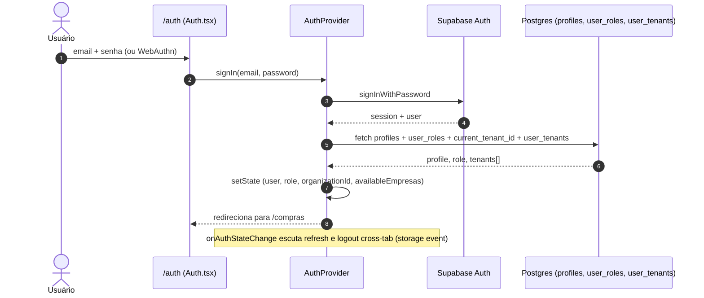
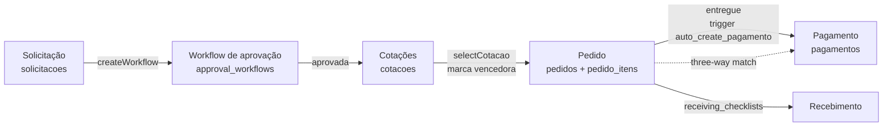
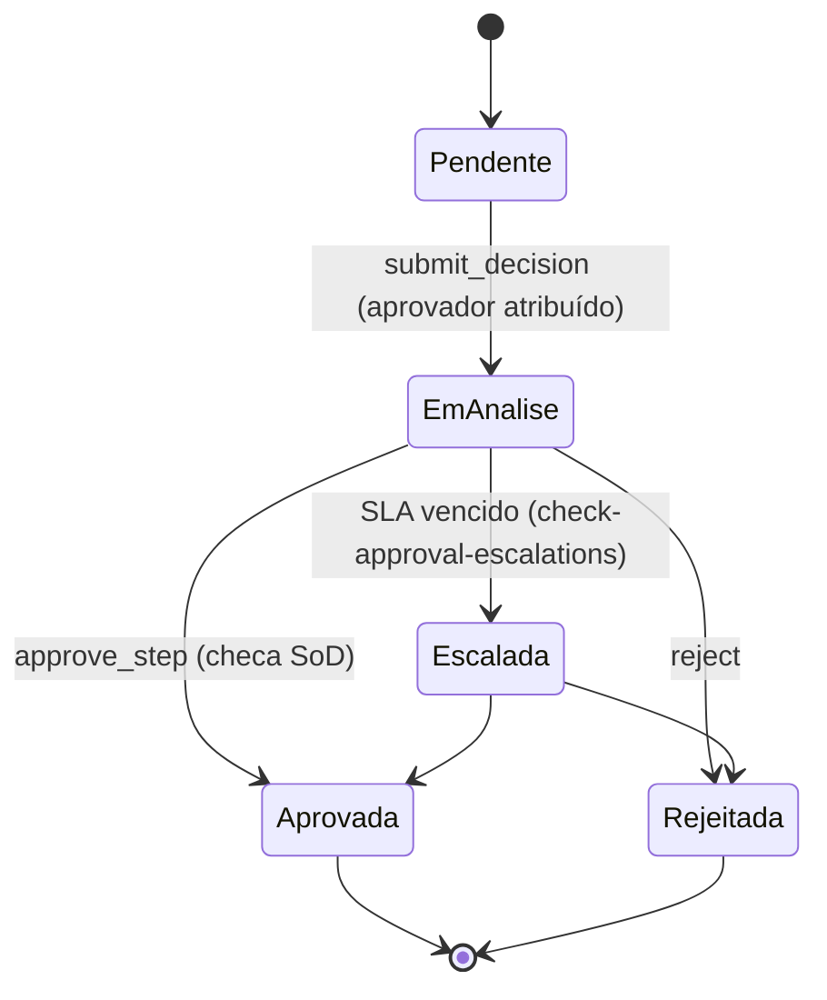
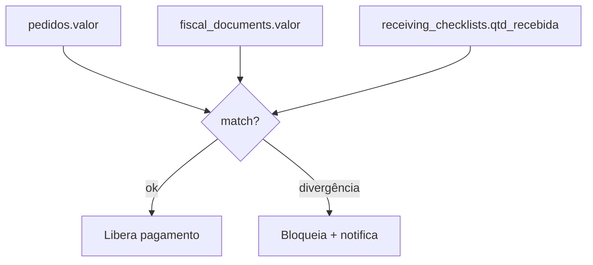
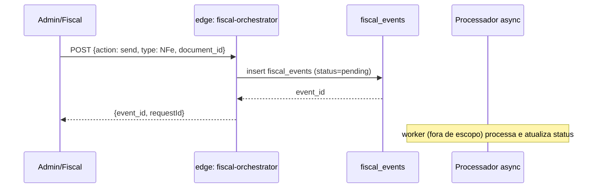
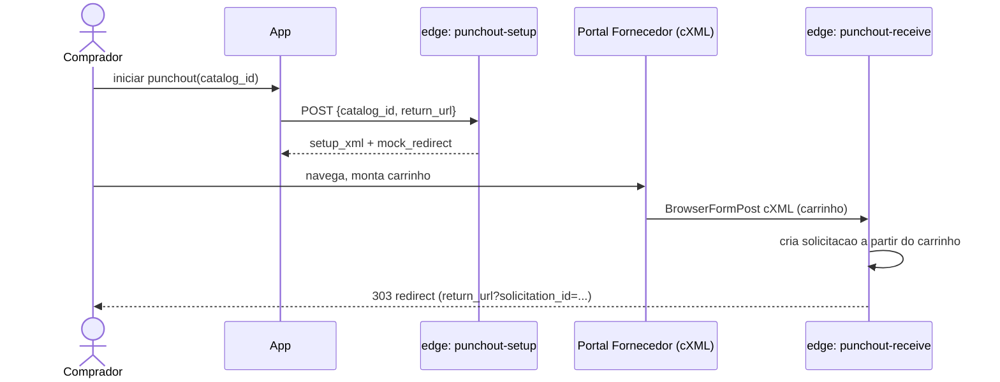

# 02. Fluxos Críticos

Documenta os principais fluxos de negócio ponta a ponta, do clique do usuário até o efeito no banco.

---

## 2.1 Autenticação e sessão

**Arquivos-chave:** `src/features/auth/hooks/useAuth.tsx:38` (`fetchUserData`), `:181` (`signIn`), `:207` (`signOut`).
**Guardas:** `src/features/auth/components/ProtectedRoute.tsx:12` — sem `user` → `<Navigate to="/auth"/>`.
**Idle timeout:** `useSessionIdleTimeout` (ver doc 07) faz logout após inatividade.

---

## 2.2 Solicitação → Cotação → Pedido → Pagamento

Fluxo central do procurement.

### Passos técnicos
1. **Criar solicitação** (`useSolicitacoes.createSolicitacao`, `src/features/solicitacoes/hooks/useSolicitacoes.ts:121`)
   - Valida com `CreateSolicitacaoSchema` (Zod).
   - RPC `check_budget_availability` verifica orçamento disponível.
   - Insert em `solicitacoes` (RLS: `tenant_in_my_group`).
   - Chama `useApprovalWorkflow().createWorkflow` → cria `approval_workflows` + `approval_steps`.
2. **Cotar** (`useCotacoes.createCotacao`, `src/features/cotacoes/hooks/useCotacoes.ts:83`)
   - Gera número sequencial via RPC `generate_sequential_number`.
   - Calcula `valor_total`.
   - Trigger `calculate_cotacao_scores` ranqueia cotações.
3. **Selecionar vencedora** (`useCotacoes.selectCotacao`, `:144`)
   - Desmarca outras cotações da mesma solicitação; marca vencedora.
   - Trigger `auto_transition_solicitacao_on_cotacao_approval` avança status.
4. **Gerar pedido** (`usePedidos.createPedido`, `src/features/pedidos/hooks/usePedidos.ts:133`)
   - Máquina de estados validada por `VALID_PEDIDO_TRANSITIONS` (`:56`).
   - Insere `pedidos` + `pedido_itens`.
   - Trigger `handle_pedido_budget_realization` reserva orçamento.
5. **Entregar** (`updateStatus('entregue')`)
   - Trigger `auto_create_pagamento_on_delivery` cria linha em `pagamentos`.
   - Trigger `auto_calculate_delivery_penalty` aplica multa se atrasado (0,5% ao dia, cap 20%).
   - Trigger `auto_update_supplier_score_on_delivery` atualiza score do fornecedor.
6. **Pagar** (`usePagamentos`)
   - Trigger `sync_budget_on_payment` realiza o gasto no orçamento.
   - Trigger `audit_pagamento_changes` grava audit log imutável.

---

## 2.3 Workflow de Aprovação

- **Regras:** `approval_rules` define quando aplicar (categoria, valor, cost center). Thresholds padrão: <5k auto-aprovado, 5–50k gerente, >50k diretoria.
- **SoD:** RPC `check_workflow_sod` bloqueia auto-aprovação (edge `workflow-engine`).
- **Delegação:** `approval_delegations` com constraint `EXCLUDE` de janelas sobrepostas (`btree_gist` + `tstzrange`).
- **Escalonamento:** cron `check-approval-escalations` promove após SLA (3d warning, 1d crítico).

Refs: `supabase/functions/workflow-engine/index.ts:7`, `src/hooks/useApprovalWorkflow.ts:17`.

---

## 2.4 Three-Way Matching

Valida antes de liberar pagamento que **PO + Recebimento + Nota Fiscal** batem.

Componente: `src/components/pagamentos/ThreeWayMatchPanel.tsx`.

---

## 2.5 Ciclo Fiscal

Ref: `supabase/functions/fiscal-orchestrator/index.ts:7`.

---

## 2.6 PunchOut (e-procurement)

Refs: `supabase/functions/punchout-setup/index.ts:5`, `supabase/functions/punchout-receive/index.ts:9`.

---

## 2.7 Devolução (RMA) + Crédito

1. Cria `devolucoes` + `devolucao_itens`.
2. Fornecedor emite crédito → registrado em `creditos_fornecedor`.
3. Ao pagar próximo pedido, crédito é abatido (campo `utilizado_em_pagamento_id`).
4. Cron `check-expiry-alerts` avisa vencimento de crédito.

Refs: `src/hooks/useDevolucoes.ts`, `src/features/pedidos` (integração).

---

## 2.8 Realtime + Cache

- Hooks CRUD assinam `useRealtimeSubscription({tables, queryKeysToInvalidate})` — mudanças no banco disparam invalidação de query keys.
- `queryClient` persiste no `localStorage` (key `PROMO_SUPPLY_CACHE`), TTL 24h, `buster = user.id` (isola por usuário; troca de usuário descarta cache).

Refs: `src/hooks/useRealtimeSubscription.ts:47`, `src/lib/query-client.ts:21`, `src/App.tsx:36`.
